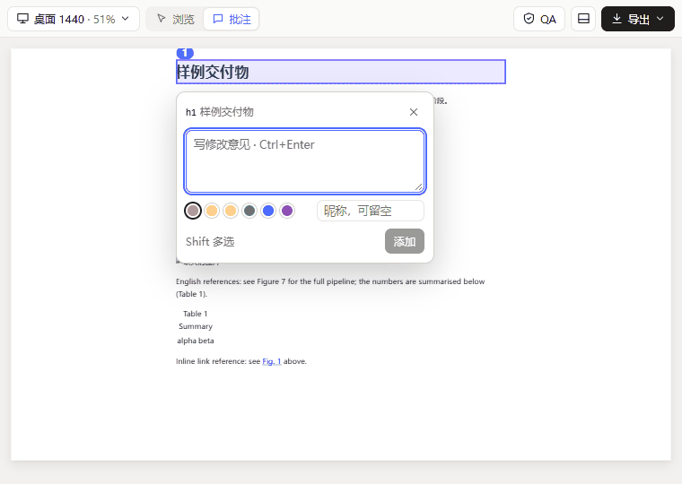
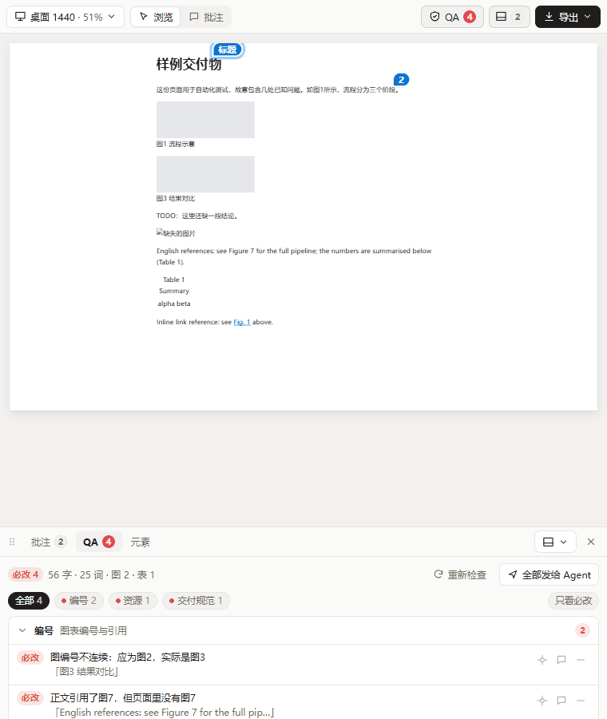
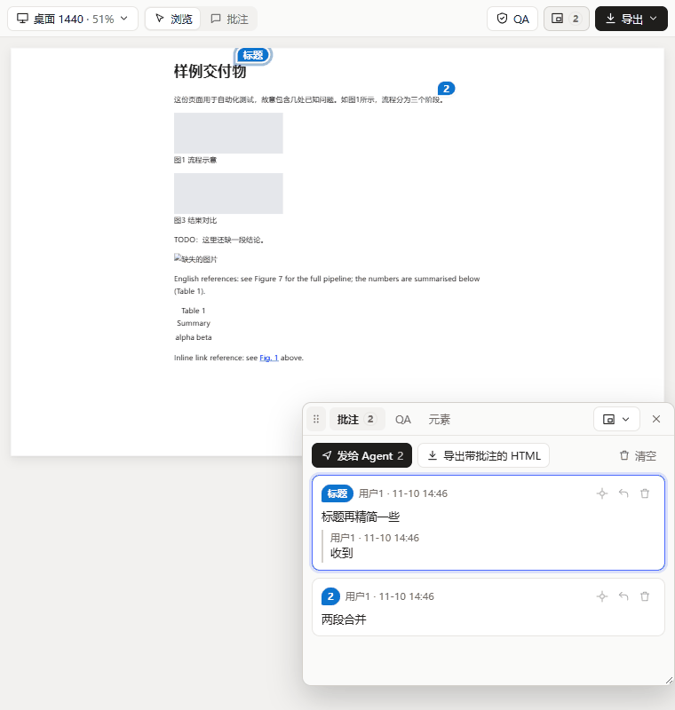
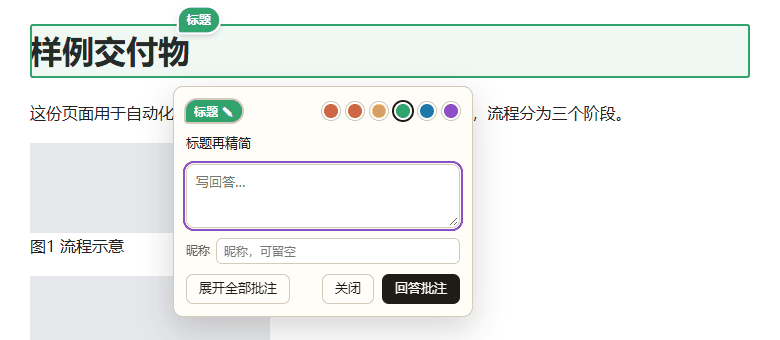
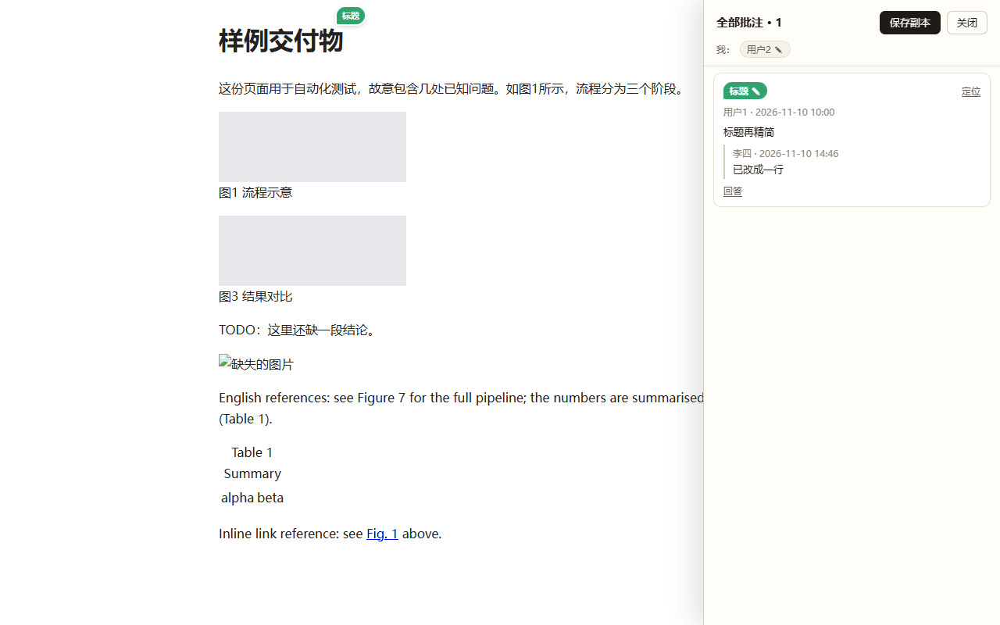

# dsh-deliver-studio · 交付工作台

DeepSeek Harness（DSH）插件：把 HTML 原型、报告、作品集等交付物放进一个「预览 → 批注 → 修改 → 导出」的工作台。批注可以导出成一份带批注的 HTML 发给别人，对方直接在浏览器里回答。

- 作者：[passenfall](https://github.com/passenfall)
- 许可：MIT
- 适用：DSH 0.2.x
- 版本：0.2.0（[更新日志](CHANGELOG.md)）

| 就地批注 | 分类 QA | 可停靠面板 |
|---|---|---|
|  |  |  |

| 带批注 HTML：点标记弹出气泡 | 带批注 HTML：展开全部批注 |
|---|---|
|  |  |

## 功能

| 功能 | 说明 |
|---|---|
| 视口预览 | 右侧文件预览打开 `.html/.htm` 时可选渲染器「交付工作台」。视口收在下拉菜单里：桌面 1440 / 笔记本 1280 / 平板 768 / 手机 390 / A4 794，按面板宽度自动缩放。页面自身的 `#/路由` 切换、锚点可正常使用；指向同目录其它 HTML 的链接在预览中打开，站外链接在新窗口打开 |
| 批注 | 工具栏「浏览 / 批注」切换。批注模式下点选元素（Shift 多选），就地弹出输入气泡：写意见、选标记颜色，首次可填昵称（可留空）。添加后页面上出现彩色标记，不会自动展开任何面板。Esc 取消当前选择，再按一次退出批注模式 |
| 面板 | 批注列表、QA、元素样式合在一个分页面板里，默认收起。可停靠底部 / 顶部 / 左侧 / 右侧或浮动：用面板位置菜单切换，或按住标题栏拖到边缘停靠、放在中间浮动；停靠时可拖动分隔条调大小，浮动时可拖角调整尺寸。位置和尺寸会被记住 |
| 批注管理 | 卡片上双击标记改名、点标记改颜色、双击内容编辑，可回复、定位、删除；作者与时间按「昵称或 用户1、用户2…」显示。「发给 Agent」把全部批注（含目标元素、路由、回复）整理成结构化消息放进输入框 |
| 导出带批注的 HTML | 在 HTML 同目录生成 `<原名>.annotated.html`（源文件已带批注时写回它自己）。打开后点标记弹出气泡：批注原文、写回答、改颜色和名称，提供【展开全部批注】【回答批注】【关闭】；「展开全部批注」列出每条批注和回答的用户名与时间。回答保存在打开它的浏览器里，「保存副本」把批注和回答写进一份新的 HTML，传回后在工作台打开即可看到 |
| 交付 QA | 图/表编号连续性与正文引用（中文「如图 3」「见表 1」，英文「see Figure 3」「see Fig. 2」「in Figure 4」「(Table 1)」）、孤字（末行只剩一两个字）、文字截断、横向溢出、A4/幻灯片页面留白与溢出、标题落在页底、文字对比度（WCAG AA）、字体与字号种类、图片加载失败/拉伸/低分辨率、页内死链、禁用字样、字数。结果按类别分组（视觉、文本、版式、编号、资源、交付规范），可按类别筛选、只看必改、折叠分组 |
| 导出 PDF | 用本机 Chromium 内核浏览器（Edge / Chrome / Chromium / Brave）无头打印：A4、保留背景色、无浏览器页眉页脚；默认先跑 QA，有必改项时先确认 |

每条 QA 结果都带级别（必改 / 建议）、CSS 选择器和修复建议；在工作台里可以「定位」「加入批注」「忽略」，或把当前筛选出的问题一次发给 Agent。

界面里的 QA 和模型工具 / 命令用的是同一份检查脚本（`runtime.js`），两条路径结果一致。

## 安装

插件没有运行时依赖，`client.js` 已预先构建，不需要 `npm install`。任选一种方式：

- **Git 地址**：打开 DSH Web，进入「插件 → 添加插件」，输入 `https://github.com/passenfall/dsh-deliver-studio`。
- **本地文件夹**：从 [Releases](https://github.com/passenfall/dsh-deliver-studio/releases) 下载 `dsh-deliver-studio-<版本>.zip` 并解压（或 `git clone` 本仓库），在「插件 → 添加插件」里输入该文件夹的绝对路径。

装好后在插件列表里找到「交付工作台」，可在它的设置页调整配置项。在右侧文件预览中打开 `.html` 文件，渲染器选「交付工作台」即可使用。

升级：Git 安装的在插件列表里更新；本地文件夹安装的，替换文件夹内容后在插件列表里停用再启用一次，并刷新 DSH 页面。

## 环境要求

- DeepSeek Harness 0.2.x
- 本机安装任一 Chromium 内核浏览器：Microsoft Edge、Google Chrome、Chromium 或 Brave

浏览器按以下顺序查找，找到即用：

1. 插件设置里的「浏览器路径」（`browserPath`）
2. 环境变量 `DELIVER_STUDIO_BROWSER`，其次 `CHROME_PATH`
3. 按平台自动查找（依次 Edge → Chrome → Chromium → Brave）
   - Windows：`%ProgramFiles%`、`%ProgramFiles(x86)%`、`%LocalAppData%` 下的标准安装目录
   - macOS：`/Applications` 与 `~/Applications` 下的 `Microsoft Edge.app`、`Google Chrome.app`、`Chromium.app`、`Brave Browser.app`
   - Linux：在 `PATH` 中查找 `microsoft-edge`、`microsoft-edge-stable`、`google-chrome`、`google-chrome-stable`、`chromium`、`chromium-browser`、`brave-browser`

插件设置页会显示「已找到：浏览器名称」或「未找到 Chromium 内核浏览器」。

## 配置项

| 键 | 默认值 | 说明 |
|---|---|---|
| `bannedWords` | `TODO`、`TBD`、`FIXME`、`待补充`、`此处替换`、`Lorem ipsum` | 交付规范：页面里出现这些字样记为必改 |
| `targetChars` | `0` | 目标字数（中文字 + 英文词）；0 表示只统计不比较，偏差超过 10% 给出建议 |
| `defaultViewport` | `desktop` | 工作台默认视口：`desktop` / `laptop` / `tablet` / `mobile` / `a4` |
| `qaBeforeExport` | `true` | 导出 PDF 前强制跑 QA，有必改项时先确认 |
| `browserPath` | 空 | 浏览器可执行文件路径；留空自动查找。macOS 上也可以填 `.app` 包路径 |
| `edgePath` | 空 | 已弃用，请改用 `browserPath`；`browserPath` 为空时仍会读取（兼容旧配置），在设置页保存一次即自动迁移 |

## 命令与工具

**命令**

| 命令 | 作用 |
|---|---|
| `/deliver qa <文件>` | 跑交付 QA，输出问题清单 |
| `/deliver export <文件> [--force]` | 导出 PDF（与 HTML 同目录同名）；有必改项时不导出，确认后加 `--force` |
| `/deliver <文件>` | 提示在右侧文件预览中打开并选择「交付工作台」 |

文件路径可以是绝对路径，或相对当前会话的工作目录。

**模型工具**（Agent 可直接调用）

| 工具 | 参数 | 作用 |
|---|---|---|
| `deliver_qa` | `path`，`viewport?` | 用无头浏览器渲染并检查，返回带级别、选择器和修复建议的清单 |
| `deliver_export_pdf` | `path`，`out?`，`force?` | 导出 PDF；默认先 QA，有必改项时返回清单而不导出，用户确认后传 `force=true` |

## 隐私说明

- 全部在本机运行：渲染、QA、导出都由本机浏览器完成，插件本身不向任何外部服务发送数据。
- 工作台与 Host 之间的接口（`/api/dsh-deliver-studio/*`）只接受来自本机回环地址（loopback）的 `POST` + JSON 请求，并校验请求来源，外部来源一律拒绝。
- 工作台的批注与面板布局保存在本机浏览器的 localStorage 里；导出带批注的 HTML 时才写入文件。带批注 HTML 里的回答同样只保存在打开它的浏览器中，「保存副本」后才写入新文件。
- QA / 导出时会在 HTML 同目录写一个临时副本（`.deliver-studio-xxxx.html`，用于加载相对路径资源），浏览器使用系统临时目录里的独立 profile；结束后两者都会删除。
- 工作台预览运行在沙箱 iframe 里（`sandbox="allow-scripts"`，无同源权限，以 `srcdoc` 装载），只通过结构化消息与界面通信。
- 页面自身引用的远程资源（如在线字体、CDN 脚本）会像普通打开网页一样由浏览器加载。

## 限制

- 浏览器查找在 Windows 上实测通过（Edge、Chrome）；macOS 与 Linux 按上面的路径规则实现，并有单元测试覆盖查找顺序，但**尚未在真机上实测**。Linux 以 root 运行时会自动加 `--no-sandbox`。
- QA 是启发式检查：图注按「图 N / 表 N / Figure N / Fig. N / Table N」开头识别；英文引用只识别 `see`、`in`、`cf.`、`refer to`、`according to` 后接或括号内的 Figure / Fig. / Table 编号。
- 工作台打包本地资源有上限：最多 80 个相对路径资源，单张图片 12 MB、单个脚本或样式 4 MB、总计 48 MB；含 `<base href>` 的页面不打包。
- PDF 页数按文件内的页面对象计数，个别生成器下可能与阅读器显示略有出入。
- 批注按 CSS 选择器 + 元素文字前 40 字定位；页面结构或文字改动较大后，旧批注可能找不到目标（列表里仍保留，「定位」会提示）。SPA 页面会记录批注时的 `#/路由`，定位时自动切过去。
- 带批注 HTML 的「保存副本」依赖浏览器的 `DecompressionStream`（Chrome / Edge 80+、Safari 16.4+、Firefox 113+）。
- 预览里页面弹窗（alert / confirm）、表单提交和新窗口会被沙箱拦截。

## 开发

```bash
# 修改 client.src.js 或 runtime.js 之后重新生成 client.js（不要手改 client.js，提交前确认已重新构建）
node build.mjs

# 打包发布：生成 dist/ 下的 .tgz 与 .zip（内容同 package.json 的 files）
node scripts/pack.mjs

# 浏览器查找规则单测（不依赖本机环境）
node test/browser-find.mjs

# Host 半边模拟：工具、命令、bridge 校验、导出拦截（需要本机浏览器 + DSH profile 的 node_modules）
node --import ./test/register.mjs test/host-sim.mjs

# 对任意 HTML 跑一次 QA / 导出
node test/browser-try.mjs <file.html> [--pdf <out.pdf>]

# 批量验证：文件清单来自参数或 DELIVER_STUDIO_SAMPLES（每行一个路径的文本文件）
node test/real-deliverables.mjs [--out <目录>] [a.html b.html ...]

# 带批注 HTML 查看器端到端（标记、气泡、回答、全部批注、改名改色、路由定位、保存副本）
PLAYWRIGHT_CORE=<playwright-core 目录> node test/viewer-e2e.mjs [file.html]

# 工作台界面端到端：真实 React 19 渲染 + 真实 Host bridge（页内导航、批注气泡、Shift 多选、Esc、面板停靠与拖动、分类 QA、导出带批注 HTML、发给 Agent）
PLAYWRIGHT_CORE=… REACT_NODE_MODULES=<含 react/react-dom/scheduler 的 node_modules> node --import ./test/register.mjs test/ui-e2e.mjs [file.html] [--shots <截图目录>]

# 浏览器内打包 → 沙箱 iframe → runtime → QA 往返（默认用 test/fixtures/sample.html）
# 用无头浏览器自动跑时加 --disable-features=IsolateSandboxedIframes（原因见 harness-server.mjs 注释）
node test/harness-server.mjs 18931
```

- `test/register.mjs` 让 Node 能解析 Host 半边的裸导入：`@deepseek-ai/schemastery` 取 DSH profile 中已安装的副本（位置由环境变量 `DSH_PROFILE_NODE_MODULES` 指定，否则为 `~/.dsh/profiles/<DSH_PROFILE 或 desktop>/node_modules`），`@deepseek-ai/dsh-tools` 用最小桩。
- 用 `DELIVER_STUDIO_BROWSER` 可以指定测试使用的浏览器。
- 结构：`index.js`（Host：配置、工具、命令、bridge）、`browser.js`（浏览器查找与无头驱动、批注嵌入块的生成与剥离，只用 Node 内置模块）、`runtime.js`（页面内 QA 脚本与预览交互）、`viewer.js`（嵌入带批注 HTML 的查看器）、`client.src.js`（浏览器半边界面，构建为 `client.js`）。

---

## English

**dsh-deliver-studio** is a DeepSeek Harness (DSH 0.2.x) plugin for HTML deliverables: viewport preview, in-place annotations (exportable as a self-contained annotated HTML that reviewers can reply to), a dockable panel, categorized delivery QA (figure/table numbering and references, orphaned words, clipped text, overflow, page whitespace, WCAG contrast, fonts, broken/stretched images, dead anchors, banned words, length) and PDF export via a local Chromium-based browser (Edge / Chrome / Chromium / Brave).

- **Install:** in DSH Web open *Plugins → Add plugin* and enter the absolute path of the plugin folder or its Git URL. No `npm install` needed.
- **Requirements:** DSH 0.2.x and any Chromium-based browser. Lookup order: `browserPath` setting → `DELIVER_STUDIO_BROWSER` / `CHROME_PATH` → standard install locations (Windows / macOS / Linux `PATH`).
- **Entry points:** `/deliver qa|export <file> [--force]`, tools `deliver_qa` and `deliver_export_pdf`, and the "Deliver Studio" renderer in the file preview.
- **Privacy:** everything runs locally; the bridge accepts loopback-only JSON POST requests with an origin check.
- **Limitations:** browser lookup on macOS and Linux follows the documented path rules and is unit-tested, but has not been verified on real machines yet.

Author: passenfall · License: MIT
